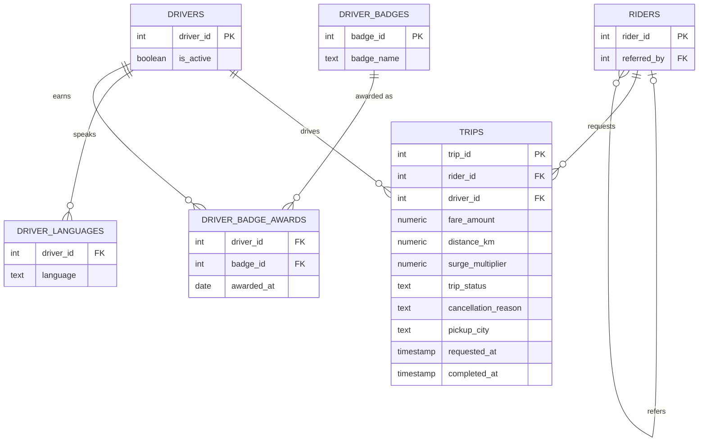

# EX603 Ride-Sharing Database (ROUTAI)

**A PostgreSQL model of a ride-sharing platform that connects riders, drivers and trips, analyzed with SQL to answer one question: is the platform getting better or worse, and which drivers are carrying it?**

**Author:** Joseph D. Fargnoli

---

## 1. The domain

ROUTAI is a ride-sharing service. Riders request trips, drivers fulfil them, and every trip ends in one of three states: completed, cancelled or disputed. The platform keeps detailed records on both sides of the marketplace. Riders can refer other riders, and drivers have languages they speak and badges they earn over time. In the course's role framework, the **driver is the producer**, the **trip is the event**, badges form the **catalog** linked through a **junction** table, and `fare_amount` is the **metric**.

The founder needs the database to answer practical operating questions. Is revenue on track against the annual target, and is it trending up or down month to month? Which drivers produce the most revenue and trips, and which have gone quiet? How often do trips fail, why do they fail, and is the failure rate improving? Which trips are unusual compared with the driver's own history?

The dataset covers calendar year 2023: 30 riders, 15 drivers and 200 trips. The analysis was built unit by unit. Unit 3 defined the schema, Unit 4 summarized the data with aggregates, Unit 5 connected the tables with joins, and Unit 6 tracked change over time with window functions.

## 2. Database overview

The schema and sample data are created by [`rideshare.sql`](rideshare.sql), the DDL delivered in Unit 3. The script drops and recreates every table, so it is safe to re-run.



| Table | Rows | Role in the analysis |
| --- | --- | --- |
| `trips` | 200 | The **event** table and the center of the analysis: 156 completed, 34 cancelled and 10 disputed. Its fare, status, cancellation reason and timestamps drive every revenue and failure query. |
| `drivers` | 15 | The **producers**. Every ranking, gap and top-N query is partitioned by driver. |
| `riders` | 30 | The customers. `referred_by` is a self-referencing foreign key, so one rider can refer another. |
| `driver_badge_awards` | 25 | A **junction** table that resolves the many-to-many relationship between drivers and badges. It feeds the badge rankings and the quarterly badge progression. |
| `driver_badges` | 5 | The **catalog** of badge types. |
| `driver_languages` | 23 | Resolves the multivalued "languages spoken" attribute into one row per driver and language. |

Unless noted otherwise, revenue analyses use completed trips only.

## 3. Query catalogue

<!-- TODO: confirm the Unit 4 and Unit 5 file names and paths match the repository before committing. -->

### Unit 4: Aggregation

| Query | Business question |
| --- | --- |
| [`sql/unit4/4_1_platform_totals.sql`](sql/unit4/4_1_platform_totals.sql) | What are total trips, total revenue, and the average, minimum and maximum fare for the year? |
| [`sql/unit4/4_2_per_driver.sql`](sql/unit4/4_2_per_driver.sql) | How much revenue and how many trips does each driver produce? |
| [`sql/unit4/4_3_having_thresholds.sql`](sql/unit4/4_3_having_thresholds.sql) | Which drivers clear a fixed threshold, and which are above the median driver? |
| [`sql/unit4/4_4_failure_counts.sql`](sql/unit4/4_4_failure_counts.sql) | How many trips completed, were cancelled or were disputed, counted in a single pass? |
| [`sql/unit4/4_5_regional_rollup.sql`](sql/unit4/4_5_regional_rollup.sql) | How does revenue split between the North and South regions, with subtotals and a grand total? |
| [`sql/unit4/4_6_high_volume_baseline.sql`](sql/unit4/4_6_high_volume_baseline.sql) | Which drivers are high-volume compared with a computed platform baseline? |

### Unit 5: Joins

| Query | Business question |
| --- | --- |
| [`sql/unit5/5_1_three_table_join.sql`](sql/unit5/5_1_three_table_join.sql) | For each trip, who was the rider and who was the driver? |
| [`sql/unit5/5_2_driver_self_join.sql`](sql/unit5/5_2_driver_self_join.sql) | Which drivers work the same city, and how does their activity compare? |
| [`sql/unit5/5_3_driver_badges.sql`](sql/unit5/5_3_driver_badges.sql) | Which badges has each driver earned (driver → junction → catalog)? |
| [`sql/unit5/5_4_join_types.sql`](sql/unit5/5_4_join_types.sql) | How do `INNER`, `LEFT`, `RIGHT` and `FULL OUTER` joins change who appears in a driver–trip report? |
| [`sql/unit5/5_5_idle_drivers.sql`](sql/unit5/5_5_idle_drivers.sql) | Which drivers are on the roster but recorded no trips (`NOT EXISTS` vs. `EXCEPT`)? |
| [`sql/unit5/5_6_no_show_riders.sql`](sql/unit5/5_6_no_show_riders.sql) | Are high driver no-show rates caused by the driver or by repeat-offending riders? |

### Unit 6: Window functions

| Query | Business question |
| --- | --- |
| [`sql/6_1_1_event_vs_producer_avg.sql`](sql/6_1_1_event_vs_producer_avg.sql) | Which trips are unusual compared with the driver's own average fare? |
| [`sql/6_1_2_rank_three_ways.sql`](sql/6_1_2_rank_three_ways.sql) | How do drivers rank on revenue, trips and badges, and how should ties be handled? |
| [`sql/6_1_3_ntile_bands.sql`](sql/6_1_3_ntile_bands.sql) | How do drivers fall into four activity bands by trip count? |
| [`sql/6_2a_row_to_row.sql`](sql/6_2a_row_to_row.sql) | How does each fare compare with the driver's previous and next trip? |
| [`sql/6_2b_running_total_moving_avg.sql`](sql/6_2b_running_total_moving_avg.sql) | Is revenue on pace for the $3,600 annual target, and what is the three-month trend? |
| [`sql/6_2c_activity_gaps.sql`](sql/6_2c_activity_gaps.sql) | Which drivers went silent for 90 days or more? |
| [`sql/6_3a_top3_per_driver.sql`](sql/6_3a_top3_per_driver.sql) | What are each driver's three best trips? |
| [`sql/6_3b_month_over_month.sql`](sql/6_3b_month_over_month.sql) | Did revenue improve or decline compared with the prior month? |
| [`sql/badge_progression_quarterly.sql`](sql/badge_progression_quarterly.sql) | How do badges accumulate per driver by quarter, and who qualifies as a "Superstar"? |
| [`sql/driver_quarterly_metrics.sql`](sql/driver_quarterly_metrics.sql) | How do each driver's revenue, trips and badges trend quarter to quarter? |
| [`sql/top_producer_monthly.sql`](sql/top_producer_monthly.sql) | How does the top-earning driver's revenue build month by month? |
| [`sql/failure_analysis.sql`](sql/failure_analysis.sql) | Is the trip-failure rate improving, and what causes failures? |

The full Unit 6 write-up is in [`analysis/unit6.md`](analysis/unit6.md), and the leadership finding is in [`analysis/unit6-finding.md`](analysis/unit6-finding.md).

## 4. Technical highlights

**Window functions instead of `GROUP BY`.** `AVG(fare_amount) OVER (PARTITION BY driver_id)` returns all 156 completed trips, each with its driver's average beside it, while `GROUP BY` collapses the same data into 13 rows. Keeping the individual rows is what made it possible to flag the nine trips worth at least double their driver's average. Aggregates answer "what is the average?"; window functions answer "is *this* trip unusual?"

**CTEs to filter window results.** A window function is evaluated after `WHERE`, so it cannot be filtered in the same query. The activity-gap and top-three queries compute `LAG` and `RANK` inside a CTE and filter in the outer query. This is how the 112-day gap for Driver_09 was found, and how the top-N query keeps tied trips at third place instead of dropping them.

**Generating a calendar before using `ROWS` frames.** A `ROWS BETWEEN 2 PRECEDING AND CURRENT ROW` frame counts rows, not months. If a month has no trips, a three-month average silently spans four months. The running-total and month-over-month queries first build a complete twelve-month calendar with `generate_series` and `LEFT JOIN` the revenue onto it, so every frame covers exactly the months it claims to. `NULLIF` guards the percentage change against division by zero.

**Joining through the junction table, and anti-joins for missing data.** Badges reach drivers only through `driver_badge_awards`, so badge analyses join driver → junction → catalog. Finding drivers with no trips used `NOT EXISTS` (and `EXCEPT` for comparison) instead of an inner join, because an inner join can never return a driver who has no matching rows. This surfaced Driver_14 and Driver_15: on the roster, with zero trips.

**`ROLLUP` and execution plans.** `GROUP BY ROLLUP` produced regional subtotals and a grand total in one query instead of three unioned queries. `EXPLAIN ANALYZE` on the three-table join showed PostgreSQL choosing hash joins, which fit small tables without supporting indexes. That plan would be expected to change as `trips` grows and indexes on `driver_id` and `rider_id` are used.

## 5. Findings and recommendations

**1. The platform finished 2023 at 95% of its revenue target, and the gap is small.** Revenue reached $3,418.75 against a $3,600 target. The $181.25 shortfall is about nine completed trips at the average fare of $21.92. The three-month moving average peaked at $340.26 in October but ended the year at $278.28, below the $300 monthly pace. Revenue is also concentrated: the top three drivers (Driver_08, Driver_10 and Driver_06) produced about 36% of it, two drivers recorded no trips, and Driver_09 went silent for 112 days.
*Recommendation:* re-engage idle drivers and contact any driver who is silent for more than twice their usual gap. Closing the shortfall takes only about nine more trips.

**2. Trip failures are flat, not improving.** 44 of 200 trips (22%) failed. Quarterly failure rates were 24.5%, 20.8%, 25.5% and 16.7%, and the two halves of the year were nearly identical (22.8% vs. 21.2%). Q4's improvement rests on only eight failures, too few to call a trend.
*Recommendation:* track failure rate monthly with a target of 15% or less, and alert when the three-month revenue average falls below $300 or any month-over-month change exceeds ±30%.

**3. Most failures have fixable, rider-side causes.** Rider no-shows (12) and rider cancellations (8) account for 59% of cancellations, followed by payment failures (7) and driver unavailability (7). The high no-show rates for Driver_02 and Driver_03 trace back to repeat-offending riders, not to the drivers. None of the 10 disputes has a recorded reason.
*Recommendation:* add a pickup-confirmation step and a modest no-show fee, pre-authorize payment when a trip is requested and retry failed charges automatically, and require a reason code on every dispute.

## 6. Limitations and future improvements

**The data cannot tell a driver who left from a driver whose trips were not recorded.** `drivers.is_active` is an undated snapshot: it marks Driver_09 as inactive even though they drove until December. The database also records only completed events, with no availability or session data, so a driver who was online but received no requests looks identical to one who stopped driving. As a result, the 112-day gap and the two idle drivers can be detected but not explained.

**What would help:** a `driver_status_history` table with timestamped status changes, driver session logs showing when each driver was online, and ingestion logs to rule out recording problems. Several years of data would also help, because with only 200 trips monthly percentages swing heavily (8 to 17 completed trips per month), and a larger sample is needed before calling any trend real.

## 7. Video presentation

[▶ Watch the project presentation](https://us06web.zoom.us/rec/play/cHlburVzPfdo24W4wTNmAa1015m12cjFsdd5wialXXPOoYgCNZHzmQzFpLxnQ0H_Q9PsuU1aIFqzHlA.oEhfZ-p_C66oYkRk
Passcode: ^!HH8zQ^)


## 8. How to run it

These steps assume only a running PostgreSQL server (version 14 or later; tested on PostgreSQL 19) and the `psql` command-line client.

**Step 1: Get the files.**

```bash
git clone https://github.com/jdfargnoli/EX603-Ride-Sharing-Database
cd https://github.com/jdfargnoli/EX603-Ride-Sharing-Database
```

**Step 2: Create the database.**

```bash
psql -U postgres -c "CREATE DATABASE ex603_rideshare;"
```

**Step 3: Create the schema and load the data.**

```bash
psql -U postgres -d ex603_rideshare -f rideshare.sql
```

**Step 4: Verify the load.** This should return riders 30, drivers 15, driver_languages 23, driver_badges 5, driver_badge_awards 25 and trips 200.

```bash
psql -U postgres -d ex603_rideshare -c "
SELECT 'riders' AS table_name, COUNT(*) FROM riders
UNION ALL SELECT 'drivers', COUNT(*) FROM drivers
UNION ALL SELECT 'driver_languages', COUNT(*) FROM driver_languages
UNION ALL SELECT 'driver_badges', COUNT(*) FROM driver_badges
UNION ALL SELECT 'driver_badge_awards', COUNT(*) FROM driver_badge_awards
UNION ALL SELECT 'trips', COUNT(*) FROM trips;"
```

**Step 5: Run a query.** Any file in the catalogue runs the same way, for example the running-total and moving-average analysis:

```bash
psql -U postgres -d ex603_rideshare -f sql/6_2b_running_total_moving_avg.sql
```

On Windows, run these commands from the **SQL Shell (psql)** in the Start menu, or add PostgreSQL's `bin` folder to your `PATH`. On Linux, you may need `sudo -u postgres psql ...` instead of `psql -U postgres ...`.

**Using a GUI instead (DataGrip or pgAdmin):** create the `ex603_rideshare` database, run `rideshare.sql` against it (in DataGrip, right-click the data source and choose **SQL Scripts → Run SQL Script**), then open any query file and execute it. Every file is commented.

